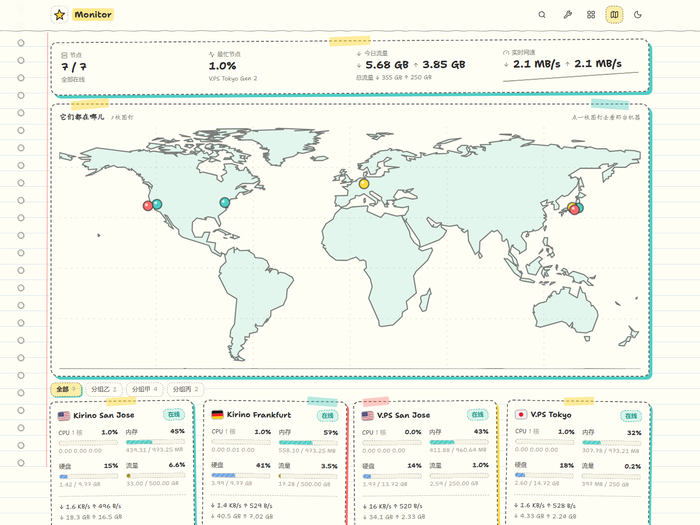
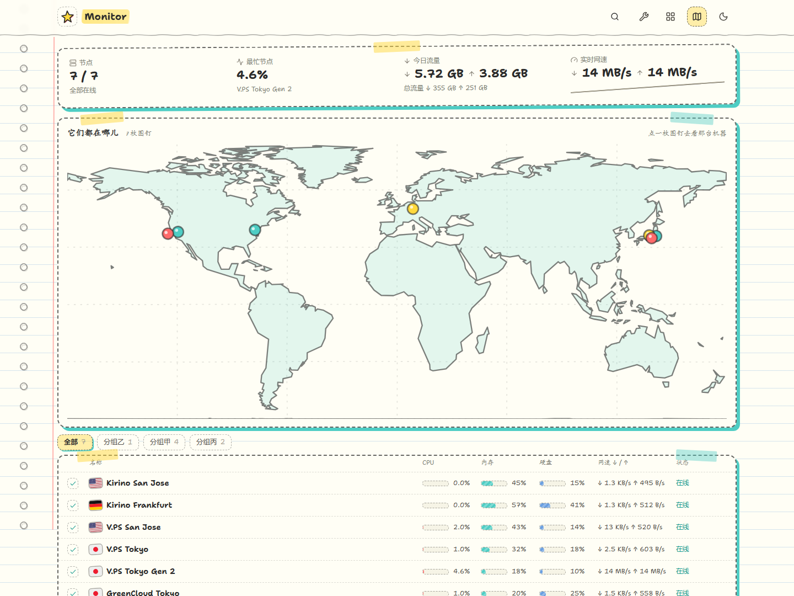

# rakugaki（涂鸦本）



极简探针（Monitor）的第三方主题。整站是一本摊开的手绘笔记本：奶白纸面铺着淡蓝横格线、
左侧一条红色页边线，所有框线都是虚线手绘的，卡片角上贴着胶带，服务器钉在一张手绘的
世界地图上。纯静态前端，只读 hub 的公开接口；国旗、图标与字体都自带，离线可用。

## 预览

卡片有两档形态，站长设默认、访客可自己在顶栏换：

| **涂鸦卡片（默认）** | **清单表格** |
|:---:|:---:|
|  |  |

## 设计概念

- **纸与横格**：整个页面就是一张稿纸——通铺淡蓝横格线（背景，随滚动到底）、左侧淡红页边线；
  宽屏（≥1400px）时页边线外侧再排一列打孔与内影，像从线圈本上撕下来的一页。
- **黑板**：暗色不是把纸面反相，是同一本本子的另一页——墨绿黑板、粉笔白字，标记笔换成
  粉笔荧光。「随北京时间自动」那档＝19:00–07:00 用黑板（访客可自行覆盖）。
- **手绘线**：框线全用虚线 + 小半径圆角 + 一丁点旋转；不细抠的角落反而对——但**歪得要有控制**：
  线条抖动全部走 `src/lib/sketch.ts` 的确定性伪随机（`rand01(n, seed)`），因为卡片每 2 秒
  刷新一次，真随机会让整张图抖个不停。走势线与延迟图叠了两层：底层是更淡的错位重描，
  像同一笔手描过两遍。
- **标记笔配色**：红 / 蓝绿 / 黄三支主笔，外加图表用的笔蓝与笔紫；胶带黄、青、粉三色半透明
  （40–55%，底下的纸透出来）。

## 节点地图书

列表页顶部贴着一张手绘世界地图（默认开着；站长在设置里关掉＝整块关，顶栏那枚开关也一起收起；
开着时访客可以自己关，选完记在他自己的浏览器里）。

- **地图本身**：等距圆柱平铺的简笔海岸线（79 个环、1483 个点，主题自带，不连任何外部服务），
  每 30° 一条经纬网，纸的四角贴胶带。平铺而非转动的球：本子里贴的就是一张地图，
  纸面上转一个地球反而怪。
- **图钉**：一台机器一枚，按地区识别落点；同城的自动岔开，谁都盖不住谁。不同颜色的图钉
  轮着用，跟卡片上的胶带颜色不是一套（地图是地图，卡片是卡片）。点图钉直接进那台机器的
  详情页；底下实时数着「几枚图钉」。
- **窄屏**：地图保留全幅可读的最小宽度，横向可拖（提示语就在地图角上）；页面本身不横向溢出。

## 卡片两档

- **涂鸦卡片（默认）**：一台一张手绘卡片——名字、在线徽章、四格读数条（CPU / 内存 / 硬盘 /
  流量，≥85% 换红笔）、上下行网速、三网延迟（延迟条 + 数字 + 丢包标注 + 迷你走势线）、
  运行时长与计费。窄屏单列，桌面两列起排。
- **清单表格**：一行一台的待办清单——勾选框 + 名称 + 三格小读数 + 网速 + 状态；
  密度最高，适合机队一屏扫完。
- **访客切换**：顶栏那枚方形图标（列表页才有）点开是两档，选中的打勾、站长设的那档标
  「默认」。选完立刻生效、刷新还记得，但**只记在访客自己的浏览器里**（localStorage），
  不写 hub——后台那格是「默认看到哪种」，访客的偏好不该改到全站；选成与站长设置相同的
  那一档时记录会被删掉 ＝ 回到「跟着站长的设置走」。

## 设置项（都在后台主题设置里）

- **节点地图**：列表页顶部那张手绘地图（关掉＝整块不渲染）。
- **列表页顶部**：分组标签行与概览便签各要哪一档（都不显示 / 只分组 / 只便签 / 都显示）。
- **卡片形态**：涂鸦卡片 / 清单表格——访客默认看到哪种（访客可自行更换）。
- **备注显示位置**：卡片与详情页都显示 / 只卡片 / 只详情 / 都不显示。备注在后台节点里填，
  逗号分隔＝多枚标签。
- **显示的延迟线路**：每行一个 ping 任务名、最多三条；留空自动取前三条。
- **主题模式**：随系统 / 随北京时间自动 / 亮色 / 暗色。

## 细节口径

- 三网延迟块在卡片上最多三条线路：延迟条按线路分别归一，数字带 `ms`，丢包非零时以红笔标注
  「丢包 x%」。
- 读数（CPU / 内存 / 硬盘 / 流量）≥85% 一律换红笔——与店面其它主题同一口径。
- 搜索框只长在列表页：收起是一枚图标，点开长成输入框；接 hub 搜索，分组与概览便签跟着
  一起收窄。
- 离线 / 未接入的机器不参与「最忙节点」与流量合计，但在列表里照常显示（红笔徽章）。
- 「随北京时间自动」在夜里与系统相反时，手机浏览器地址栏那圈颜色（`theme-color`）也跟着
  页面实际用的明暗走。

## 开发

```bash
npm install
npm run dev        # 本地开发（vite）
npm run build      # 产物 dist/
npm run check      # 校验 theme.json 与源码里的设置口径一致
npm test           # lib 层的单测（format / summary / search / site-settings …）
npm run lint       # oxlint
```

取景（对着真 hub 拍一轮截图）：

```bash
ssh -f -N -L 28085:127.0.0.1:28080 <你的跳板别名>   # 开一条到 hub 的隧道
node tools/shot.mjs http://127.0.0.1:28085 shots/round1
node tools/probe.mjs http://127.0.0.1:28085 /node/1 "<任意要在页面里跑的 JS>"
```

`tools/shot.mjs` 会自己把 `dist/` 伺服起来、把 `/api/*` 转发到上游 hub、开一个 headless
Chrome 逐张拍（亮 / 暗、桌面 / 手机、列表 / 详情 / 延迟），并打印每张图的现场事实
（卡片数、图钉数、文本等），方便对着数字核。`tools/serve.mjs` 也可单独用：
`node tools/serve.mjs <端口> <config.json 覆盖> <主题色覆盖> <上游 hub>`。

## 目录

```
src/
  index.css           设计系统全在这：纸与墨的 token、笔记本纸张、.dg-* 组件长相
  App.tsx             列表页（便签 / 地图 / 分组 / 搜索 / 两档列表）
  components/         NodeCard Checklist Memo MapSheet DoodleChart ChartTooltip
                      NodeDetail Latency Meter SearchBox CardStyleMenu …
  lib/                api format summary search site-settings theme-config
                      sketch（确定性抖动） map（平铺地图） region（地区识别）
public/fonts/         Shantell Sans ×3 + Caveat（拉丁子集，见 FONTS.md）
public/flags/         国旗
tools/                serve.mjs shot.mjs probe.mjs make_icons.py
```

## 许可

代码以 MIT 发布（见 [LICENSE](LICENSE)）；随附字体与视觉来源见 [FONTS.md](FONTS.md)。
